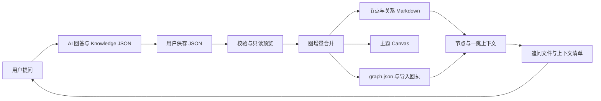

# 本地 MVP 架构

## 组件

bridge.py 集中实现输入读取、语义结构校验、图合并、文件生成和事务写入。query_builder.py 复用路径与笔记约定，读取图和当前节点笔记生成提示词。import_gui.ps1 是命令行的 Windows 交互入口，不重新实现图合并。

当前保持两个 Python 模块，避免在验证前拆分成大量层或插件架构。后续有明确需求时再抽出 parser、graph_store、generators 等模块。

## 状态与文件

`_AIKG/graph.json` 保存规范化图及正文、来源、候选状态。节点笔记中的管理区是生成视图，区外人工正文另行保留并进入追问上下文。Relations 存放稳定关系 ID 的独立解释。Canvas 只使用短边标签和节点文件引用。

`_AIKG/bridge/state.json` 记录曾接入文件的管理区指纹；imports 保存规范化批次、原始字节与回执；backups 保存旧文件和事务清单。这些是私人运行数据，不提交到公开示例。

## 合并与保护

节点按 ID 合并，名称相同但 ID 不同会阻止导入。已有节点正文采用追加方式，不删除旧段落。关系按端点和类型识别，analogy/difference 排序去重。同种有向关系的新反向边提示可能冲突，需显式保留；其他语义矛盾不自动判断。

导入计划包含目标文件的新字节与旧字节。执行前检查文件有无变化，再创建导入锁、备份、按文件原子替换。普通异常恢复已写文件。多文件事务不能覆盖断电等进程外故障，需按清单恢复。

节点或关系已有人改过管理区时，以指纹冲突报告保护编辑；手写区可继续编辑。第一次接入旧仓库只建立当前基线并追加，不证明旧生成区来自可信来源。

## 查询上下文

默认一跳，最多 12 个邻居；稳定 ID 排序。当前正文与人工区各有长度限制，关系详情过长时截断并记入 selection。全上下文默认上限 16000 字符。不会把整个 Vault 的正文发送给 AI，也没有自动发送；仅包含已有 ID 清单用于防止重复概念。

## 非目标

当前无数据库服务、API 密钥、后台监听、剪贴板监控、跨主题合并、Obsidian 插件或协同同步。源码协作通过 Git，个人知识库各自保管。
